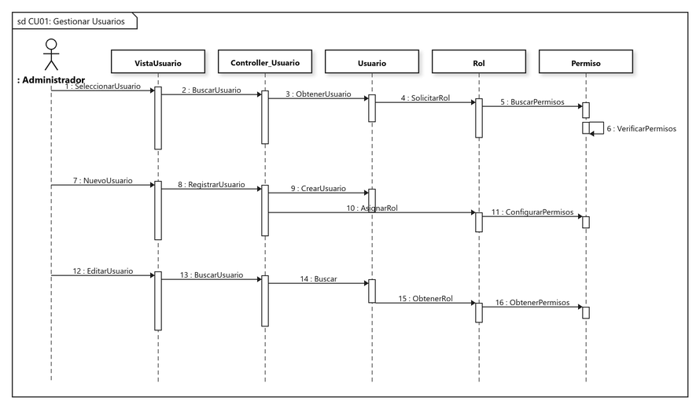
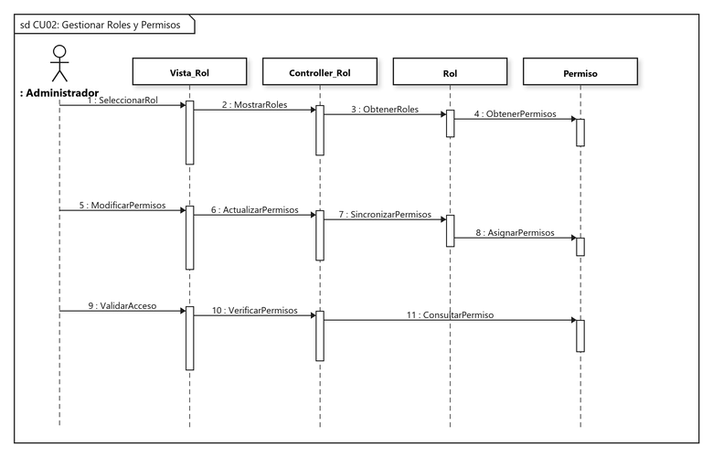
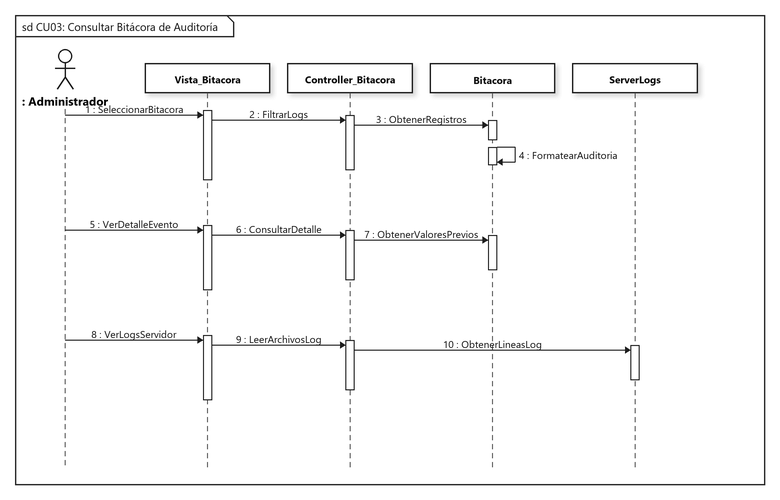
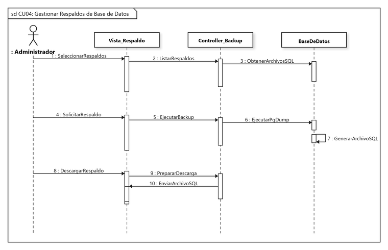
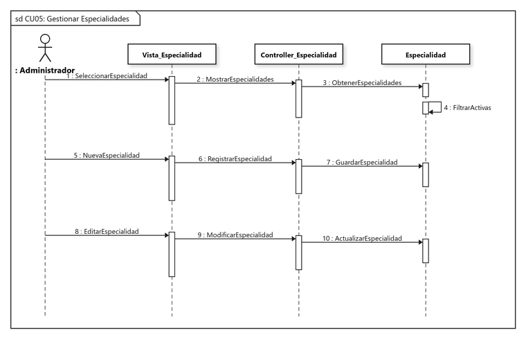
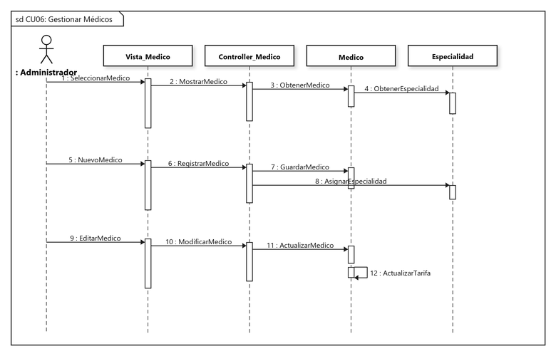
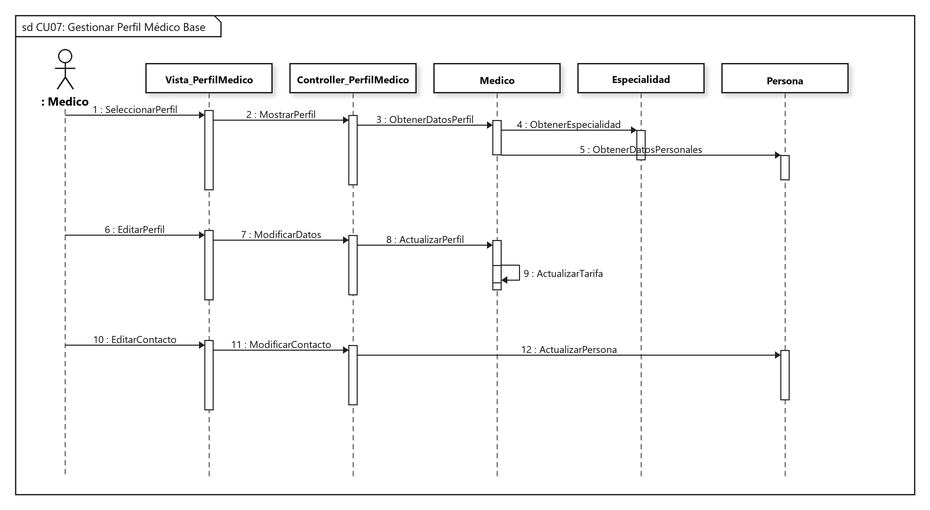
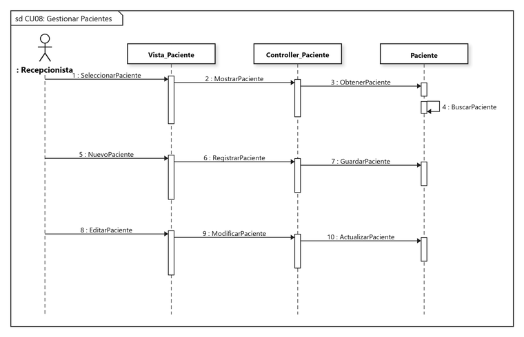

# Diseño de Casos de Uso: Diagramas de Secuencia UML
## Sistema de Información para la Gestión, Programación y Control de Citas Médicas - Clínica Vida Salud
**Universidad Autónoma Gabriel René Moreno (UAGRM) - Grupo #25**

---

### 1. Marco Metodológico y Estructura Arquitectónica

Siguiendo el estándar del **Proceso Unificado de Desarrollo de Software (PUDS / RUP)** y los requisitos de la Sección 6.2 (*Diseñar Casos de Uso - Diagrama de Secuencia*), los diagramas de secuencia modelan la interacción dinámica entre actores y objetos del sistema siguiendo el patrón arquitectónico **Modelo - Vista - Controlador (MVC)**:

1. **Actor (`: Rol`):** El usuario que interactúa con la interfaz (Administrador, Recepcionista, Médico).
2. **Capa Vista / Boundary (`Vista_Entidad`):** Componentes visuales e interfaces desarrolladas en Vue 3 / Inertia.js.
3. **Capa Controlador / Control (`Controller_Entidad`):** Controladores backend de Laravel que procesan las solicitudes, aplican reglas de validación y coordinan la transacción.
4. **Capa Modelo / Entidad (`Entidad`):** Modelos Eloquent de Laravel y tablas relacionales de PostgreSQL 18.

---

### 2. Los 8 Casos de Uso del Hito del 50% (Ciclo 1)

| Código | Caso de Uso | Actor Principal | Componentes Involucrados |
| :---: | :--- | :--- | :--- |
| **CU-01** | Gestionar Usuarios (Login, Bloqueo, Resend) | `: Administrador` | `VistaUsuario`, `Controller_Usuario`, `Usuario`, `Rol`, `Permiso` |
| **CU-02** | Gestionar Roles y Permisos | `: Administrador` | `Vista_Rol`, `Controller_Rol`, `Rol`, `Permiso` |
| **CU-03** | Consultar Bitácora de Auditoría | `: Administrador` | `Vista_Bitacora`, `Controller_Bitacora`, `Bitacora`, `ServerLogs` |
| **CU-04** | Gestionar Respaldos de Base de Datos | `: Administrador` | `Vista_Respaldo`, `Controller_Backup`, `BaseDeDatos` |
| **CU-05** | Gestionar Especialidades | `: Administrador` | `Vista_Especialidad`, `Controller_Especialidad`, `Especialidad` |
| **CU-06** | Gestionar Médicos | `: Administrador` | `Vista_Medico`, `Controller_Medico`, `Medico`, `Especialidad` |
| **CU-07** | Gestionar Perfil Médico Base | `: Medico` | `Vista_PerfilMedico`, `Controller_PerfilMedico`, `Medico`, `Especialidad`, `Persona` |
| **CU-08** | Gestionar Pacientes | `: Recepcionista` | `Vista_Paciente`, `Controller_Paciente`, `Paciente` |

---

### 3. Diagramas de Secuencia Detallados

---

#### 1. CU-01: Gestionar Usuarios
Modela el control de acceso, login, bloqueo de cuenta y administración de usuarios, roles y permisos.

- **Escenario 1 (Consulta de Usuarios y Roles):** Búsqueda de usuario, obtención del rol asignado y verificación de permisos.
- **Escenario 2 (Alta de Usuario):** Registro de usuario, asignación de rol y configuración de permisos de acceso.
- **Escenario 3 (Edición de Usuario):** Actualización de credenciales y sincronización de roles en el servidor.

---

#### 2. CU-02: Gestionar Roles y Permisos
Modela el control de acceso basado en roles (RBAC) y la matriz de privilegios del sistema.

- **Escenario 1 (Consulta de Roles):** Listado de roles del sistema y consulta de permisos asociados.
- **Escenario 2 (Modificación de Permisos):** Sincronización en caliente de permisos activados para un rol.
- **Escenario 3 (Validación de Acceso):** Verificación de autorización en el servidor ante rutas protegidas.

---

#### 3. CU-03: Consultar Bitácora de Auditoría
Modela el registro inmutable de transacciones del sistema y el visor de registros técnicos del servidor.

- **Escenario 1 (Filtrado de Auditoría):** Búsqueda de registros por fecha, módulo, acción y usuario.
- **Escenario 2 (Detalle de Transacción):** Inspección de valores previos y nuevos (`JSON diff`) del registro modificado.
- **Escenario 3 (Logs del Servidor):** Lectura en tiempo real de los archivos de log del framework (`laravel.log`).

---

#### 4. CU-04: Gestionar Respaldos de Base de Datos
Modela la generación y descarga segura de copias de seguridad de la base de datos PostgreSQL.

- **Escenario 1 (Listado de Copias):** Consulta de respaldos SQL disponibles en el almacenamiento local.
- **Escenario 2 (Generación de Respaldo):** Ejecución de la utilidad `pg_dump` para generar un volcado íntegro de la BD `clinica`.
- **Escenario 3 (Descarga):** Preparación y descarga segura del archivo `.sql` hacia la estación de trabajo.

---

#### 5. CU-05: Gestionar Especialidades
Modela el catálogo de especialidades médicas ofrecidas por la clínica (Cardiología, Pediatría, Medicina General, etc.).

- **Escenario 1 (Consulta):** Filtrado y obtención de especialidades activas.
- **Escenario 2 (Registro):** Creación de nueva especialidad con descripción y estado activo.
- **Escenario 3 (Modificación):** Modificación del nombre, descripción o desactivación lógica.

---

#### 6. CU-06: Gestionar Médicos
Modela el registro de profesionales médicos, su especialidad y tarifa de consulta individual.

- **Escenario 1 (Consulta):** Visualización de la plantilla médica activa y sus especialidades.
- **Escenario 2 (Registro):** Alta de médico, asignación de especialidad y registro de tarifa de consulta.
- **Escenario 3 (Modificación):** Actualización de consultorio, tarifa y datos profesionales.

---

#### 7. CU-07: Gestionar Perfil Médico Base
Modela la gestión de información profesional complementaria directamente por el médico (tarifa, biografía, consultorio y contacto).

- **Escenario 1 (Consulta de Perfil):** El médico accede a su perfil, obteniendo sus datos profesionales, su especialidad y sus datos personales de contacto.
- **Escenario 2 (Edición de Información Profesional):** Actualización de biografía médica, consultorio asignado y tarifa de consulta.
- **Escenario 3 (Actualización de Contacto):** Modificación de teléfono de contacto y correo institucional en la entidad Persona.

---

#### 8. CU-08: Gestionar Pacientes
Modela el catálogo maestro de pacientes para el agendamiento y control de historial de citas.

- **Escenario 1 (Consulta):** Listado y búsqueda de pacientes registrados en la clínica.
- **Escenario 2 (Registro):** Registro de datos personales (nombre, CI, fecha de nacimiento, teléfono y contacto de emergencia).
- **Escenario 3 (Modificación):** Actualización de datos de contacto y antecedentes clínicos.
