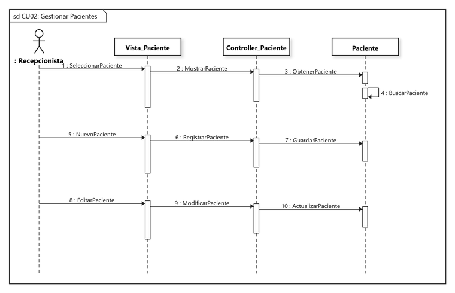
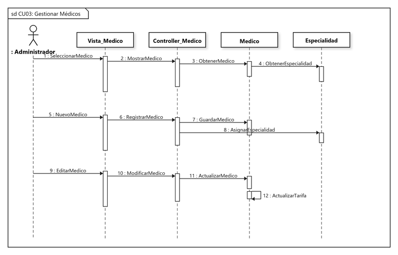
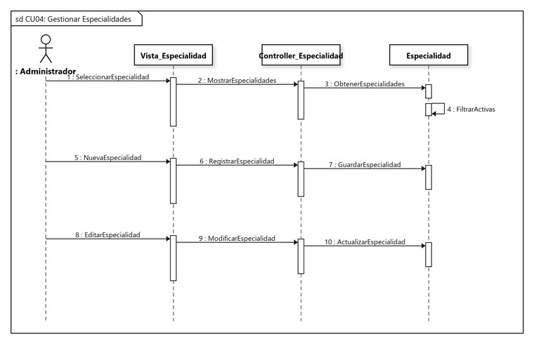
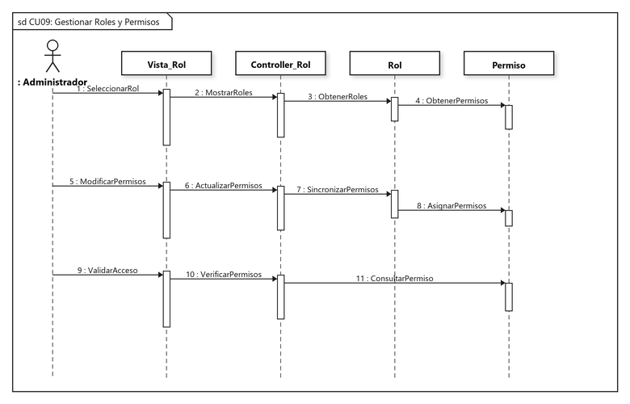
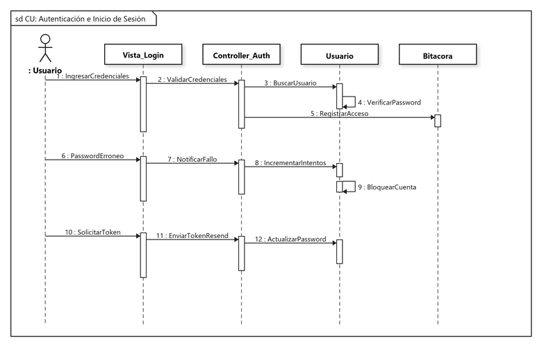

# Diseño de Casos de Uso: Diagramas de Secuencia UML
## Sistema de Información para la Gestión, Programación y Control de Citas Médicas - Clínica Vida Salud
**Universidad Autónoma Gabriel René Moreno (UAGRM) - Grupo #25**

---

### 1. Marco Metodológico y Estructura Arquitectónica

Siguiendo el estándar del **Proceso Unificado de Desarrollo de Software (PUDS / RUP)** y los requisitos de la Sección 6.2 (*Diseñar Casos de Uso - Diagrama de Secuencia*), los diagramas de secuencia modelan la interacción dinámica entre actores y objetos del sistema siguiendo el patrón arquitectónico **Modelo - Vista - Controlador (MVC)**:

1. **Actor (`: Rol`):** El usuario humano que interactúa con la interfaz (Administrador, Recepcionista, Médico, Paciente).
2. **Capa Vista / Boundary (`Vista_Entidad`):** Componentes visuales e interfaces desarrolladas en Vue 3 / Inertia.js.
3. **Capa Controlador / Control (`Controller_Entidad`):** Controladores backend de Laravel que procesan las solicitudes, aplican reglas de validación y coordinan la transacción.
4. **Capa Modelo / Entidad (`Entidad`):** Modelos Eloquent de Laravel y tablas relacionales de PostgreSQL 18.

---

### 2. Resumen de los 8 Casos de Uso Desarrollados (Ciclo 1)

| Código | Caso de Uso | Actor Principal | Componentes Involucrados |
| :---: | :--- | :--- | :--- |
| **CU-01** | Gestionar Usuarios | `: Administrador` | `VistaUsuario`, `Controller_Usuario`, `Usuario`, `Rol`, `Permiso` |
| **CU-02** | Gestionar Pacientes | `: Recepcionista` | `Vista_Paciente`, `Controller_Paciente`, `Paciente` |
| **CU-03** | Gestionar Médicos | `: Administrador` | `Vista_Medico`, `Controller_Medico`, `Medico`, `Especialidad` |
| **CU-04** | Gestionar Especialidades | `: Administrador` | `Vista_Especialidad`, `Controller_Especialidad`, `Especialidad` |
| **CU-09** | Gestionar Roles y Permisos | `: Administrador` | `Vista_Rol`, `Controller_Rol`, `Rol`, `Permiso` |
| **CU-10** | Consultar Bitácora de Auditoría | `: Administrador` | `Vista_Bitacora`, `Controller_Bitacora`, `Bitacora`, `ServerLogs` |
| **CU-11** | Gestionar Respaldos de BD | `: Administrador` | `Vista_Respaldo`, `Controller_Backup`, `BaseDeDatos` |
| **CU-Auth** | Autenticación e Inicio de Sesión | `: Usuario` | `Vista_Login`, `Controller_Auth`, `Usuario`, `Bitacora` |

---

### 3. Diagramas de Secuencia Detallados

---

#### 1. CU-01: Gestionar Usuarios
Modela la administración integral de credenciales, roles asignados y permisos operativos de acceso al sistema.

- **Escenario 1 (Consulta):** El Administrador selecciona un usuario en la vista, el controlador obtiene los datos del modelo `Usuario`, solicita su `Rol` asociado y consulta los `Permisos` asignados.
- **Escenario 2 (Registro):** Ingreso de datos del nuevo usuario, creación de la entidad en base de datos, asignación del rol y configuración de privilegios.
- **Escenario 3 (Edición):** Búsqueda y actualización de datos de cuenta y sincronización de roles/permisos.

---

#### 2. CU-02: Gestionar Pacientes
Modela el catálogo maestro de pacientes para el agendamiento y control de historial de citas.

- **Escenario 1 (Consulta):** Listado y búsqueda de pacientes registrados en la clínica.
- **Escenario 2 (Registro):** Registro de datos personales (nombre, CI, fecha de nacimiento, teléfono y contacto de emergencia).
- **Escenario 3 (Modificación):** Actualización de datos de contacto y antecedentes clínicos.

---

#### 3. CU-03: Gestionar Médicos
Modela el registro de profesionales médicos, su especialidad principal y sus tarifas por consulta.

- **Escenario 1 (Consulta):** Visualización de la plantilla médica activa y sus especialidades asociadas.
- **Escenario 2 (Registro):** Alta de médico, asignación de especialidad y registro de tarifa de consulta individual.
- **Escenario 3 (Modificación):** Actualización de teléfono, consultorio asignado y tarifa médica.

---

#### 4. CU-04: Gestionar Especialidades
Modela el catálogo de especialidades médicas ofrecidas por la clínica (Cardiología, Pediatría, Medicina General, etc.).

- **Escenario 1 (Consulta):** Filtrado y obtención de especialidades activas.
- **Escenario 2 (Registro):** Creación de nueva especialidad médica con descripción y estado.
- **Escenario 3 (Modificación):** Modificación del nombre, descripción o desactivación lógica de la especialidad.

---

#### 5. CU-09: Gestionar Roles y Permisos
Modela el control de acceso basado en roles (RBAC) y la matriz de privilegios del sistema.

- **Escenario 1 (Consulta):** Obtención de roles definidos (Administrador, Recepcionista, Médico, Paciente) y permisos asignados.
- **Escenario 2 (Asignación):** Sincronización en caliente de permisos activados/desactivados para un rol.
- **Escenario 3 (Validación):** Verificación de autorización en el servidor ante solicitudes protegidas.

---

#### 6. CU-10: Consultar Bitácora de Auditoría
Modela el registro inmutable de transacciones del sistema y el visor de registros técnicos del servidor.

- **Escenario 1 (Filtrado de Auditoría):** Búsqueda de registros por fecha, módulo, acción y usuario responsable.
- **Escenario 2 (Detalle de Transacción):** Visualización de valores previos y nuevos (`JSON diff`) del registro modificado.
- **Escenario 3 (Logs del Servidor):** Lectura y análisis en tiempo real de los archivos de log de Laravel (`laravel.log`).

---

#### 7. CU-11: Gestionar Respaldos de Base de Datos
Modela la generación y descarga segura de copias de seguridad de la base de datos PostgreSQL.

- **Escenario 1 (Listado):** Consulta de respaldos SQL disponibles en el almacenamiento del servidor.
- **Escenario 2 (Generación):** Ejecución de la utilidad `pg_dump` para generar un volcado íntegro de la base de datos `clinica`.
- **Escenario 3 (Descarga):** Preparación de la descarga cifrada del archivo `.sql` hacia el equipo del Administrador.

---

#### 8. CU-Auth: Autenticación e Inicio de Sesión
Modela el proceso de seguridad en el acceso: login seguro, protección contra fuerza bruta y recuperación con token.

- **Escenario 1 (Autenticación Exitosa):** Verificación de credenciales (correo y contraseña con Hash Bcrypt) y registro en bitácora.
- **Escenario 2 (Bloqueo de Intentos):** Conteo de fallos consecutivos y bloqueo automático de la cuenta al superar el umbral permitido.
- **Escenario 3 (Recuperación de Contraseña):** Generación de token de 6 dígitos, envío mediante Resend API y restablecimiento seguro.
