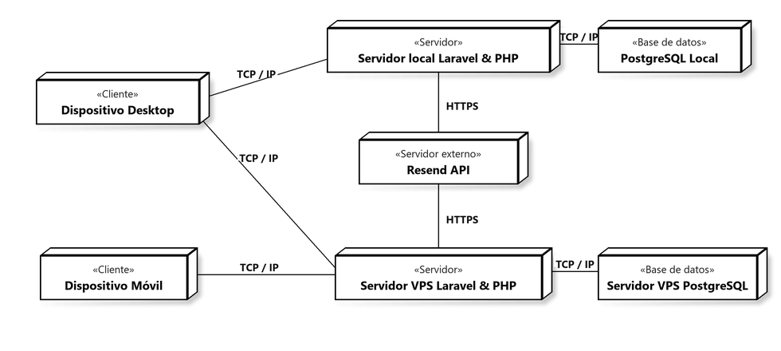

# Diagrama de Despliegue UML (Físico y Lógico)
## Sistema de Información para la Gestión, Programación y Control de Citas Médicas - Clínica Vida Salud
**Universidad Autónoma Gabriel René Moreno (UAGRM) - Grupo #25**

---

### 1. Vista General del Diagrama

El **Diagrama de Despliegue** modela la arquitectura de ejecución del sistema, ilustrando la distribución física y lógica de los componentes de software en los diferentes nodos de hardware y entornos de red (Entorno de Desarrollo Local, Entorno de Producción en Servidor VPS y Servicios Externos en la Nube).



> **Archivos generados disponibles en el repositorio:**
> - Formato PNG de alta resolución: [`docs/diagramas/diagrama_despliegue.png`](file:///c:/Users/Cerezo%20Alex/OneDrive/Escritorio/CONTROL%20DE%20CITAS/docs/diagramas/diagrama_despliegue.png)
> - Formato vectorial escalable (SVG): [`docs/diagramas/diagrama_despliegue.svg`](file:///c:/Users/Cerezo%20Alex/OneDrive/Escritorio/CONTROL%20DE%20CITAS/docs/diagramas/diagrama_despliegue.svg)
> - Script generador automatizado: [`generate_deployment_diagram.py`](file:///c:/Users/Cerezo%20Alex/OneDrive/Escritorio/CONTROL%20DE%20CITAS/generate_deployment_diagram.py)

---

### 2. Tabla Comparativa: Ejemplo del Compañero vs. Proyecto Clínica Vida Salud

Para cumplir con la directriz académica de **fidelidad técnica y no inventar servicios innecesarios**, se realizó la adaptación precisa del modelo:

| Elemento / Nodo | Ejemplo del Compañero | Adaptación Real para Clínica Vida Salud | Justificación Técnica del Proyecto |
| :--- | :--- | :--- | :--- |
| **Cliente Escritorio** | «Cliente» Dispositivo Desktop | **«Cliente» Dispositivo Desktop** | Computadoras del personal administrativo, recepcionistas y médicos navegando vía Chrome / Edge / Firefox. |
| **Cliente Móvil** | «Cliente» Dispositivo Móvil | **«Cliente» Dispositivo Móvil** | Dispositivos móviles (smartphones/tablets) de pacientes para agendamiento y médicos para consulta responsiva. |
| **Servidor de Desarrollo** | «Servidor» Servidor local Laravel & PHP | **«Servidor» Servidor local Laravel & PHP** | Entorno local con PHP 8.2, servidor integrado de Laravel (`artisan serve`) y servidor de assets (`Vite`). |
| **Base de Datos Local** | «Base de datos» MySQL Local | **«Base de datos» PostgreSQL Local** | **PostgreSQL versión 18** gestionado mediante **pgAdmin** en el puerto local `5432` con driver PDO `pgsql`. |
| **Servidor de Producción**| «Servidor» Railway Laravel & PHP | **«Servidor» Servidor VPS Laravel & PHP** | Servidor **VPS Linux Ubuntu** administrado por el equipo con Nginx, PHP 8.2-FPM y Laravel. |
| **Base de Datos Producción**| «Base de datos» Railway MySQL | **«Base de datos» Servidor VPS PostgreSQL** | Instancia de **PostgreSQL en Servidor VPS** en red interna/puerto `5432`. |
| **Servicios Externos** | «Servidor externo» Gemini API<br>«Servidor externo» Stripe | **«Servidor externo» Resend API** | **Exclusivamente Resend API**: El alcance oficial (Sección 1.4) prohíbe pasarelas de pago (Stripe) y cobros para el ciclo de 4 semanas. Resend es el servicio real en uso para envío de tokens de recuperación de 6 dígitos y notificaciones de citas por correo. |

---

### 3. Especificación Detallada de Nodos y Protocolos

```mermaid
flowchart TD
    subgraph Clientes["Capa de Presentación / Clientes"]
        Desktop["«Cliente»<br><b>Dispositivo Desktop</b><br>(Navegador Web)"]
        Mobile["«Cliente»<br><b>Dispositivo Móvil</b><br>(Navegador Web Móvil)"]
    end

    subgraph Desarrollo["Entorno de Desarrollo Local"]
        ServerLocal["«Servidor»<br><b>Servidor local Laravel & PHP</b><br>(PHP 8.2 / Artisan / Vite)"]
        DBLocal["«Base de datos»<br><b>PostgreSQL Local</b><br>(Puerto 5432 / pgAdmin)"]
    end

    subgraph Nube["Servicios Externos en la Nube"]
        Resend["«Servidor externo»<br><b>Resend API</b><br>(https://api.resend.com/emails)"]
    end

    subgraph Produccion["Entorno de Producción (VPS)"]
        ServerVPS["«Servidor»<br><b>Servidor VPS Laravel & PHP</b><br>(Linux Ubuntu / Nginx / PHP-FPM)"]
        DBVPS["«Base de datos»<br><b>Servidor VPS PostgreSQL</b><br>(Instancia PostgreSQL Producción)"]
    end

    Desktop -->|TCP / IP| ServerLocal
    Desktop -->|TCP / IP| ServerVPS
    Mobile -->|TCP / IP| ServerVPS

    ServerLocal -->|TCP / IP (5432)| DBLocal
    ServerLocal -->|HTTPS / REST| Resend

    ServerVPS -->|TCP / IP (5432)| DBVPS
    ServerVPS -->|HTTPS / REST| Resend
```

#### A. Nodos Clientes
- **`«Cliente» Dispositivo Desktop`**:
  - **Hardware/Dispositivo:** Computadora de escritorio o estación de trabajo (PC/Laptop).
  - **Software/Artefacto:** Navegador Web moderno (Google Chrome, Mozilla Firefox, Microsoft Edge).
  - **Rol:** Utilizado principalmente por el Administrador de la clínica, Médicos y Recepcionistas para el registro de catálogos, asignación de turnos, consulta de bitácoras y gestión integral de citas.
  - **Protocolo de conexión:** Conexión `TCP / IP` (vía HTTP/HTTPS) hacia el servidor local en fase de pruebas o hacia el servidor VPS en producción.

- **`«Cliente» Dispositivo Móvil`**:
  - **Hardware/Dispositivo:** Teléfono inteligente o tablet con conexión a Internet.
  - **Software/Artefacto:** Navegador móvil (Safari, Chrome Mobile).
  - **Rol:** Utilizado por pacientes para consultar horarios de especialidades médicas, solicitar citas y recibir confirmaciones, o por médicos para revisar su agenda de pacientes.
  - **Protocolo de conexión:** Conexión `TCP / IP` (vía HTTPS) hacia el servidor VPS de producción.

#### B. Nodos de Desarrollo Local
- **`«Servidor» Servidor local Laravel & PHP`**:
  - **Entorno:** Sistema operativo Windows del desarrollador.
  - **Componentes:** PHP 8.2.12 CLI, Laravel Framework 12, Vite Dev Server, Node.js / pnpm, Inertia.js.
  - **Función:** Ejecución de pruebas unitarias y de integración (`php artisan test`), compilación en caliente de componentes Vue 3 y controladores backend.
  - **Protocolo hacia Base de Datos:** Conexión `TCP / IP` en `127.0.0.1:5432`.
  - **Protocolo hacia API Externa:** Conexión `HTTPS` mediante cliente HTTP de Laravel (Guzzle) hacia `https://api.resend.com`.

- **`«Base de datos» PostgreSQL Local`**:
  - **Gestor:** PostgreSQL versión 18 (Servicio local `postgresql-x64-18`).
  - **Herramienta de administración:** pgAdmin 4.
  - **Esquema:** Base de datos relacional `clinica` con tablas normalizadas, secuencias `SERIAL` y llaves foráneas íntegras.

#### C. Nodo de Servicios Externos
- **`«Servidor externo» Resend API`**:
  - **Proveedor:** Resend (`https://resend.com`).
  - **Servicio:** API REST transaccional de correo electrónico (`POST https://api.resend.com/emails`).
  - **Propósito en el sistema:** Envío seguro de tokens numéricos de 6 dígitos para recuperación de contraseña y notificación automatizada al paciente sobre citas programadas o reprogramadas.
  - **Autenticación:** Encabezado HTTP `Authorization: Bearer RESEND_API_KEY` protegido en el archivo de variables de entorno `.env`.

#### D. Nodos de Producción en VPS
- **`«Servidor» Servidor VPS Laravel & PHP`**:
  - **Entorno:** Servidor Virtual Privado (VPS) Linux Ubuntu Server en la nube.
  - **Componentes:** Servidor web Nginx (como proxy inverso y terminador SSL), PHP 8.2-FPM (FastCGI Process Manager) y aplicación Laravel compilada en modo producción.
  - **Seguridad:** Certificado SSL/TLS con cifrado HTTPS obligatorio para todo el tráfico de clientes.

- **`«Base de datos» Servidor VPS PostgreSQL`**:
  - **Gestor:** Servidor de base de datos PostgreSQL en el VPS.
  - **Seguridad:** Configuración restringida en `pg_hba.conf` y `postgresql.conf` para aceptar exclusivamente conexiones locales del servidor de aplicaciones o túnel SSH seguro.
