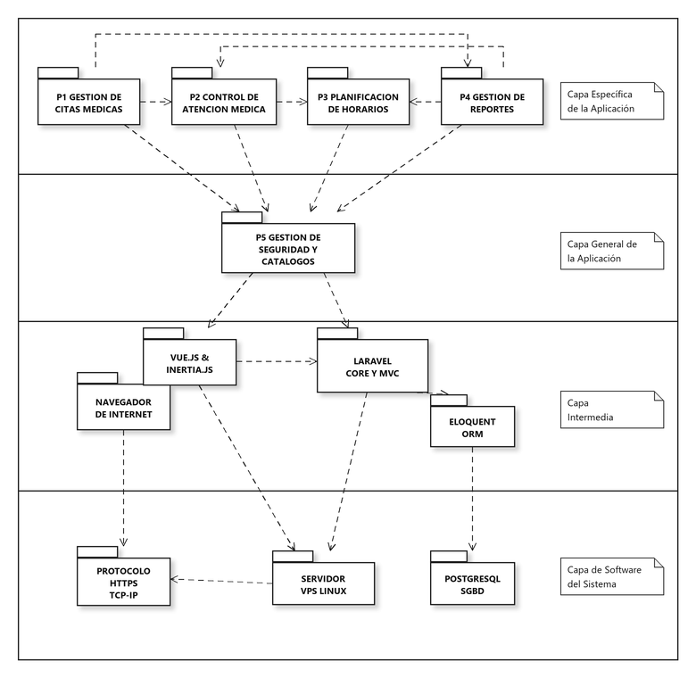
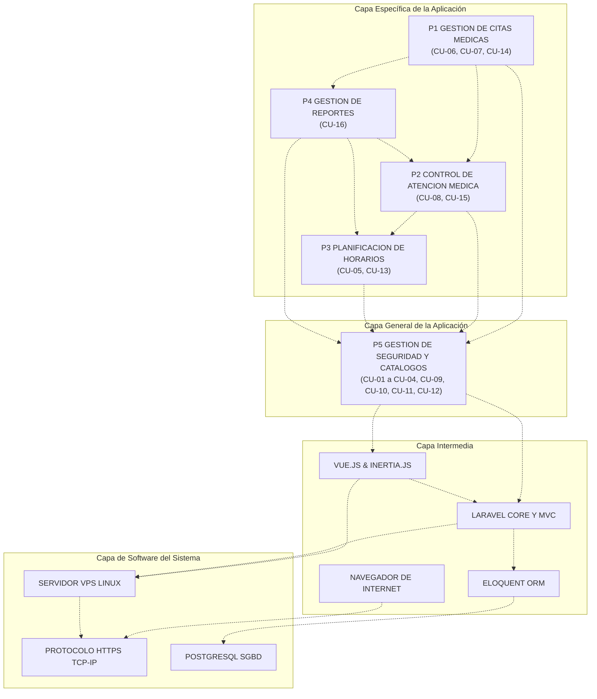

# Diagrama de Paquetes Organizado en Capas (Arquitectura Lógica)
## Sistema de Información para la Gestión, Programación y Control de Citas Médicas - Clínica Vida Salud
**Universidad Autónoma Gabriel René Moreno (UAGRM) - Grupo #25**

---

### 1. Vista General del Diagrama

El **Diagrama de Paquetes Organizado en Capas** representa la **Arquitectura Lógica** del sistema siguiendo el patrón clásico de **4 capas de Philippe Kruchten** (adoptado por el Proceso Unificado de Desarrollo de Software - PUDS / RUP).

Este diagrama estructura las dependencias lógicas del software para asegurar un **bajo acoplamiento y alta cohesión**, garantizando que las capas superiores utilicen los servicios de las capas inferiores sin generar ciclos de dependencia indebidos.

> **Archivos disponibles en el proyecto:**
> - Formato PNG de alta definición: [`docs/diagramas/diagrama_paquetes_capas.png`](file:///c:/Users/Cerezo%20Alex/OneDrive/Escritorio/CONTROL%20DE%20CITAS/docs/diagramas/diagrama_paquetes_capas.png)
> - Formato vectorial SVG (escalable para informes): [`docs/diagramas/diagrama_paquetes_capas.svg`](file:///c:/Users/Cerezo%20Alex/OneDrive/Escritorio/CONTROL%20DE%20CITAS/docs/diagramas/diagrama_paquetes_capas.svg)
> - Script generador automatizado: [`generate_package_diagram.py`](file:///c:/Users/Cerezo%20Alex/OneDrive/Escritorio/CONTROL%20DE%20CITAS/generate_package_diagram.py)

---

### 2. Tabla Comparativa: Ejemplo del Compañero vs. Adaptación Real del Proyecto

Cumpliendo con la instrucción estricta de **no inventar servicios ni componentes ajenos**, se realizó una adaptación transparente y técnicamente fiel a la realidad del sistema de la Clínica Vida Salud:

| Capa / Elemento | Ejemplo del Compañero | Adaptación Real Clínica Vida Salud | Justificación Técnica del Proyecto |
| :--- | :--- | :--- | :--- |
| **Capa 1: Específica** | P2 GESTION COMERCIAL Y FACTURACION | **P1 GESTION DE CITAS MEDICAS** | La Sección 1.4 del alcance prohíbe facturación/pagos. Nuestro núcleo transaccional es la búsqueda de disponibilidad, programación, reprogramación y cancelación de citas médicas. |
| **Capa 1: Específica** | P1 GESTION DE RECEPCION | **P2 CONTROL DE ATENCION MEDICA** | Control del flujo de asistencia (Programada, Confirmada, Atendida, Inasistencia) e historial clínico de citas del paciente. |
| **Capa 1: Específica** | P3 GESTION ADMINISTRATIVA (duplicado) | **P3 PLANIFICACION DE HORARIOS** | Definición de horarios regulares de atención, bloques de tiempo y gestión de ausencias/excepciones médicas. |
| **Capa 1: Específica** | P4 GESTION OPERATIVA | **P4 GESTION DE REPORTES** | Generación de reportes administrativos y estadísticos de citas por fecha, médico, especialidad y estado. |
| **Capa 2: General** | P3 GESTION ADMINISTRATIVA | **P5 GESTION DE SEGURIDAD Y CATALOGOS** | Servicios transversales compartidos por toda la clínica: Gestión de Usuarios, Roles, Permisos (RBAC), Bitácora de Auditoría, Respaldos de BD y Catálogos Maestros (Médicos, Pacientes, Especialidades). |
| **Capa 3: Intermedia** | LARAVEL BLADE | **VUE.JS & INERTIA.JS** | Nuestra capa de interfaz de usuario utiliza **Vue 3 + Inertia.js**, comunicándose de forma reactiva con el backend sin recargas de página tradicionales. |
| **Capa 3: Intermedia** | LARAVEL CORE Y MVC | **LARAVEL CORE Y MVC** | Núcleo del framework Laravel 12 (enrutador, middleware, controladores, validaciones de servidor). |
| **Capa 3: Intermedia** | ELOQUENT ORM | **ELOQUENT ORM** | Capa de abstracción de datos y mapeo objeto-relacional de Laravel. |
| **Capa 3: Intermedia** | NAVEGADOR DE INTERNET | **NAVEGADOR DE INTERNET** | Entorno de ejecución del cliente en navegadores web modernos (Chrome, Edge, Safari, Firefox). |
| **Capa 4: Software Sistema** | PLATAFORMA DE RAILWAY | **SERVIDOR VPS LINUX** | Servidor Virtual Privado (VPS) basado en Linux Ubuntu con Nginx y PHP-FPM donde se aloja el sistema. |
| **Capa 4: Software Sistema** | MySQL SGBD | **POSTGRESQL SGBD** | Motor de base de datos relacional **PostgreSQL versión 18** utilizado en el proyecto (puerto 5432). |
| **Capa 4: Software Sistema** | PROTOCOLO HTTPS TCP-IP | **PROTOCOLO HTTPS TCP-IP** | Pila de protocolos de comunicación web segura y transporte de red. |

---

### 3. Descripción Detallada de las 4 Capas de la Arquitectura

#### 1. Capa Específica de la Aplicación
Contiene los subsistemas de negocio directamente relacionados con la funcionalidad clínica de citas:
- **`P1 GESTIÓN DE CITAS MÉDICAS`**: Centraliza la lógica de agendamiento: búsqueda de disponibilidad de médicos, reserva de cupos, reprogramación con validación anti-solapamiento y cancelaciones con justificación.
- **`P2 CONTROL DE ATENCIÓN MÉDICA`**: Administra la llegada del paciente a la clínica, el cambio de estado de la cita a *Atendida* o *Inasistencia*, y la consulta del historial de visitas por paciente.
- **`P3 PLANIFICACIÓN DE HORARIOS`**: Establece los horarios regulares de atención de cada médico (días de la semana, hora de inicio/fin, duración por cita) y registra ausencias programadas o licencias médicas.
- **`P4 GESTIÓN DE REPORTES`**: Agrega datos de citas, especialidades y médicos para generar métricas estadísticas y reportes administrativos en formatos imprimibles y PDF.

#### 2. Capa General de la Aplicación
Contiene la infraestructura de lógica empresarial compartida que soporta transversalmente a los paquetes específicos:
- **`P5 GESTIÓN DE SEGURIDAD Y CATÁLOGOS BASE`**:
  - Catálogos compartidos de Pacientes, Médicos y Especialidades.
  - Autenticación, control de acceso basado en roles (Administrador, Recepcionista, Médico, Paciente).
  - Bitácora de auditoría inmutable de transacciones.
  - Utilidades de respaldos de base de datos.

#### 3. Capa Intermedia (Framework y Middleware)
Provee los servicios y abstracciones para el procesamiento de peticiones y persistencia:
- **`NAVEGADOR DE INTERNET`**: Cliente web donde se ejecutan los scripts del frontend y se visualiza la interfaz.
- **`VUE.JS & INERTIA.JS`**: Renderizado dinámico de vistas, componentes reactivos, modales y validaciones en el navegador.
- **`LARAVEL CORE Y MVC`**: Gestión de rutas web, inyección de dependencias, controladores, requests y middleware de seguridad.
- **`ELOQUENT ORM`**: Abstracción orientada a objetos para operaciones CRUD, transacciones con bloqueo de registros (`DB::transaction`) y relaciones entre tablas.

#### 4. Capa de Software del Sistema
Infraestructura base física y de plataforma:
- **`PROTOCOLO HTTPS TCP-IP`**: Transporte y cifrado de extremo a extremo mediante TLS/SSL.
- **`SERVIDOR VPS LINUX`**: Sistema operativo del servidor en producción (Ubuntu Server con Nginx y PHP-FPM).
- **`POSTGRESQL SGBD`**: Motor de base de datos relacional con soporte transaccional ACID, secuencias de claves y restricciones de integridad foránea.
